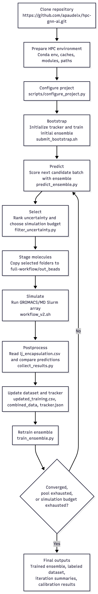

# HPC GNN Active Learning Pipeline

This repository combines a graph neural network (GNN) model with an HPC
GROMACS workflow for active learning over coarse-grained molecule candidates.
The usual loop is:

1. Train an initial GNN ensemble on molecules with known encapsulation values.
2. Predict new candidate molecules.
3. Select high-uncertainty candidates.
4. Run the selected molecules through the `full-workflow` GROMACS pipeline.
5. Add completed simulation values back into the training set.
6. Retrain the ensemble and repeat.

The project now includes a setup helper at `scripts/configure_project.py` so
new users can update HPC paths and Slurm settings globally instead of editing
each shell script by hand.

## Workflow Diagram

<div align="center">
  
  <p>Figure 1. End-to-end active learning workflow for GNN-guided molecular simulation on HPC.</p>
</div>

## Installation Procedure

Clone this repo onto a work or scratch filesystem, not into a quota-limited home
directory:

```bash
export WORK_ROOT=/work/$USER
mkdir -p "$WORK_ROOT"
cd "$WORK_ROOT"

git clone https://github.com/apaudelx/hpc-gnn-al.git
cd hpc-gnn-al
```

For a first setup on a new HPC system, the recommended order is:

1. Clone the repository under work/scratch storage.
2. Configure Conda, package caches, and temporary directories under work/scratch
   storage.
3. Create and test the `hpc-gnn-al` Conda environment.
4. Run `scripts/configure_project.py --dry-run` with your cluster paths.
5. Apply `scripts/configure_project.py` without `--dry-run`.
6. Verify `PipelineConfig()` resolves the expected `dee_gnn` and
   `full-workflow` paths.
7. Submit the active-learning bootstrap job.

Minimal command path after Conda is ready:

```bash
cd /work/$USER/hpc-gnn-al

python3 scripts/configure_project.py --dry-run \
  --dee-gnn-root /work/$USER/hpc-gnn-al/dee_gnn \
  --full-workflow-root /work/$USER/hpc-gnn-al/full-workflow \
  --conda-prefix /work/$USER/conda \
  --conda-env hpc-gnn-al \
  --slurm-account your_account \
  --cpu-partition checkpt \
  --gpu-partition gpu2

python3 scripts/configure_project.py \
  --dee-gnn-root /work/$USER/hpc-gnn-al/dee_gnn \
  --full-workflow-root /work/$USER/hpc-gnn-al/full-workflow \
  --conda-prefix /work/$USER/conda \
  --conda-env hpc-gnn-al \
  --slurm-account your_account \
  --cpu-partition checkpt \
  --gpu-partition gpu2

cd dee_gnn
bash active_learning/submit_bootstrap.sh
```

## Repository Layout

```text
.
├── dee_gnn/
│   ├── main.py                         # Thin train/predict entrypoint
│   ├── src/                            # GNN model, graph building, train/inference
│   ├── config/config.json              # Model hyperparameters
│   ├── data/                           # Training data, molecule folders, NBFIX table
│   ├── pool_1/                         # Candidate molecules for active learning
│   ├── active_learning/
│   │   ├── config.py                   # Active-learning config loader
│   │   ├── pipeline_config.json        # User/HPC configurable pipeline settings
│   │   ├── tracker.json                # Pipeline state
│   │   ├── scripts/                    # Predict/filter/collect/retrain steps
│   │   ├── slurm/                      # Slurm jobs for each pipeline stage
│   │   └── submit_*.sh                 # Dependency-chain submission helpers
│   └── reset_pipeline.sh               # Clean generated active-learning artifacts
├── full-workflow/
│   ├── workflow_v2.sh                  # One-molecule GROMACS workflow
│   ├── submit_array.sh                 # Slurm array worker
│   ├── submit_array_helper.sh          # Submit standalone molecule array
│   ├── repository/                     # Files copied into each molecule run
│   └── post_pro_dir/                   # Post-processing scripts
└── scripts/configure_project.py        # Global path/Slurm configuration helper
```

### File and Directory Guide

Core GNN files:

- `dee_gnn/main.py`: user-facing wrapper for standalone training and prediction.
- `dee_gnn/src/train.py`: trains one GNN model, saves checkpoints, metrics,
  scalers, bead-type maps, and plots.
- `dee_gnn/src/inference.py`: loads a trained model and predicts encapsulation
  for compound IDs, CSVs, or molecule folders.
- `dee_gnn/src/build_graphs.py`: converts `.itp` and molecule data into graph
  tensors for PyTorch Geometric.
- `dee_gnn/src/parse_itp.py`: parses coarse-grained topology and NBFIX files.
- `dee_gnn/src/gnn_model.py`: GNN architecture.
- `dee_gnn/config/config.json`: default model hyperparameters.

Active-learning files:

- `dee_gnn/active_learning/config.py`: central configuration class. It loads
  `active_learning/pipeline_config.json` automatically when that file exists.
- `dee_gnn/active_learning/pipeline_config.json`: user-editable pipeline
  settings, including dataset paths, simulation path, ensemble size, uncertainty
  threshold, and Slurm defaults.
- `dee_gnn/active_learning/tracker.py`: state-management helper for processed
  molecules, ensemble model paths, and iteration history.
- `dee_gnn/active_learning/tracker.json`: generated pipeline state. Keep this
  file if you want to resume a run; remove it only for a full restart.
- `dee_gnn/active_learning/scripts/init_pipeline.py`: discovers candidate
  molecules and initializes the tracker.
- `dee_gnn/active_learning/scripts/train_ensemble.py`: trains the active-learning
  ensemble by launching repeated calls to `src/train.py`.
- `dee_gnn/active_learning/scripts/predict_ensemble.py`: runs ensemble
  prediction on the next active-learning batch.
- `dee_gnn/active_learning/scripts/filter_uncertainty.py`: chooses molecules to
  simulate and stages them under `full-workflow/out_beads/`.
- `dee_gnn/active_learning/scripts/collect_results.py`: reads GROMACS outputs,
  updates training CSVs, records iteration summaries, and refreshes tracker
  state.
- `dee_gnn/active_learning/slurm/*.slurm`: Slurm job scripts for bootstrap,
  predict, filter, simulate, postprocess, and retrain stages.
- `dee_gnn/active_learning/submit_bootstrap.sh`: submits the one-time bootstrap
  job.
- `dee_gnn/active_learning/submit_iteration.sh`: submits one dependency-chained
  active-learning iteration.
- `dee_gnn/active_learning/submit_multi_iteration.sh`: submits multiple chained
  iterations.

Simulation files:

- `full-workflow/workflow_v2.sh`: full one-molecule MD workflow, including
  preparation, GROMACS stages, trajectory processing, LJ extraction, and CSV
  generation.
- `full-workflow/submit_array.sh`: Slurm array worker for standalone simulation
  batches.
- `full-workflow/submit_array_helper.sh`: detects staged molecule directories
  and submits the standalone simulation array.
- `full-workflow/repository/`: force-field, topology, MDP, TCL, Python, and
  Packmol inputs copied into each molecule run directory.
- `full-workflow/post_pro_dir/`: post-processing scripts copied into
  `out_beads/` for LJ aggregation and CSV generation.

Setup file:

- `scripts/configure_project.py`: updates user-specific paths, Conda prefix,
  Slurm account, partitions, and module names across known project files.
- `.gitignore`: excludes generated logs, model outputs, caches, simulation
  staging directories, and active-learning state from public commits.

## Required Software

Python/GNN side:

- Python 3.10 or newer is recommended.
- `numpy`, `pandas`, `scipy`, `scikit-learn`, `matplotlib`, `joblib`
- `torch`
- `torch_geometric`

Simulation/HPC side:

- Slurm (`sbatch`, `squeue`, `scancel`)
- GROMACS MPI executable exposed as `gmx_mpi`
- A matching GROMACS environment module, currently defaulting to
  `gromacs/2021.7/intel-2021.5.0-intel-mpi-2021.5.1`
- Packmol, available through the configured Conda prefix
- VMD, available through `module load vmd`
- `mdvwhole` available on `PATH`

Torch and PyTorch Geometric installation depends on your CUDA and cluster
module stack. Install the PyTorch/PyG wheels that match your cluster rather
than copying a wheel command from another machine.

## HPC Conda and Cache Setup

Most HPC systems enforce small home-directory quotas. Do not put Conda
installations, Conda package caches, pip caches, PyTorch caches, or large build
temporary files in `$HOME`. Install Conda itself under a work/scratch filesystem
and configure cache locations before installing heavy packages such as PyTorch
or PyTorch Geometric.

Use paths that match your cluster. The example below keeps the repository,
Conda installation, environments, caches, and temporary files under `/work`.

```bash
export WORK_ROOT=/work/$USER
export CONDA_ROOT=$WORK_ROOT/conda
export CONDA_ENVS_PATH=$WORK_ROOT/conda/envs
export CONDA_PKGS_DIRS=$WORK_ROOT/conda/pkgs
export PIP_CACHE_DIR=$WORK_ROOT/.cache/pip
export XDG_CACHE_HOME=$WORK_ROOT/.cache
export TORCH_HOME=$WORK_ROOT/.cache/torch
export MPLCONFIGDIR=$WORK_ROOT/.cache/matplotlib
export TMPDIR=$WORK_ROOT/tmp

mkdir -p \
  "$CONDA_ENVS_PATH" \
  "$CONDA_PKGS_DIRS" \
  "$PIP_CACHE_DIR" \
  "$TORCH_HOME" \
  "$MPLCONFIGDIR" \
  "$TMPDIR"
```

If Conda is already installed in `$HOME`, the safest production approach is to
install a fresh Miniforge, Mambaforge, or Miniconda distribution into
`$CONDA_ROOT`, configure it, recreate the environment there, and verify jobs
before deleting old home-directory files.

Example fresh Miniforge-style setup:

```bash
# Download the installer according to your cluster policy, then run:
bash Miniforge3-*.sh -b -p "$CONDA_ROOT"

source "$CONDA_ROOT/etc/profile.d/conda.sh"

conda config --set auto_activate_base false
conda config --add envs_dirs "$CONDA_ENVS_PATH"
conda config --add pkgs_dirs "$CONDA_PKGS_DIRS"
conda config --show envs_dirs
conda config --show pkgs_dirs
```

Make these exports persistent for interactive shells and Slurm jobs. A common
pattern is to add them to `~/.bashrc`, `~/.bash_profile`, or a cluster-specific
module/init script:

```bash
export WORK_ROOT=/work/$USER
export CONDA_ROOT=$WORK_ROOT/conda
export CONDA_ENVS_PATH=$WORK_ROOT/conda/envs
export CONDA_PKGS_DIRS=$WORK_ROOT/conda/pkgs
export PIP_CACHE_DIR=$WORK_ROOT/.cache/pip
export XDG_CACHE_HOME=$WORK_ROOT/.cache
export TORCH_HOME=$WORK_ROOT/.cache/torch
export MPLCONFIGDIR=$WORK_ROOT/.cache/matplotlib
export TMPDIR=$WORK_ROOT/tmp
export HPC_CONDA_PREFIX=$CONDA_ROOT
export HPC_CONDA_ENV=hpc-gnn-al
```

Caution: moving Conda after it has already been installed can break shebangs,
absolute paths in package metadata, activation scripts, and compiled packages.
Avoid `mv ~/anaconda3 /work/$USER/conda` unless you know your Conda distribution
and installed packages are relocatable. Prefer a clean install into the work
directory, then recreate the environment. Before removing anything from `$HOME`,
confirm `which python`, `conda info`, `pip cache dir`, and a small Slurm test job
all point to work-directory paths.

Create the project environment:

```bash
source "$CONDA_ROOT/etc/profile.d/conda.sh"
conda create -n hpc-gnn-al python=3.10 pip -y
conda activate hpc-gnn-al
python -m pip install --upgrade pip setuptools wheel
```

Recommended installation approach: install the core dependencies manually first,
especially PyTorch and PyTorch Geometric, because they must match the
CUDA/compiler stack available on your HPC cluster. Use `requirements.txt` as a
fallback or reproducibility aid only after the core stack is working, or if you
cannot resolve the installation manually.

```bash
python -m pip install numpy pandas scipy scikit-learn matplotlib joblib tqdm
# Install torch and torch_geometric with the command recommended for your CUDA stack.
```

If your cluster provides Packmol only through Conda, install it into the same
environment:

```bash
conda install -c conda-forge packmol -y
```

If manual installation is not enough, install from `requirements.txt`:

```bash
cd /work/$USER/hpc-gnn-al
python -m pip install -r requirements.txt
```

Caution: a `requirements.txt` generated from an existing Conda environment can
contain non-portable entries such as `package @ file:///...`. Those paths only
exist on the machine that produced the file. If pip reports missing local file
URLs, remove or regenerate those entries with portable package pins before
using the file on a different HPC system.

Sanity checks:

```bash
which python
python -c "import torch; print(torch.__version__)"
python -c "import torch_geometric; print(torch_geometric.__version__)"
which packmol
conda info | grep -E 'envs directories|package cache'
pip cache dir
```

The Slurm scripts use `HPC_CONDA_PREFIX` to find `conda.sh` and
`HPC_CONDA_ENV` to activate the environment. This applies to GPU training jobs
and simulation jobs, so install both Python/GNN packages and Packmol into the
configured environment unless your cluster provides them through modules.

## Configure Paths and Slurm Settings

Run the configurator from the repository root after copying the project to the
machine or HPC filesystem where jobs will run.

Preview changes first:

```bash
python3 scripts/configure_project.py --dry-run \
  --dee-gnn-root /work/$USER/hpc-gnn-al/dee_gnn \
  --full-workflow-root /work/$USER/hpc-gnn-al/full-workflow \
  --conda-prefix /work/$USER/conda \
  --conda-env hpc-gnn-al \
  --slurm-account your_account \
  --cpu-partition checkpt \
  --gpu-partition gpu2
```

Apply the same command without `--dry-run`:

```bash
python3 scripts/configure_project.py \
  --dee-gnn-root /work/$USER/hpc-gnn-al/dee_gnn \
  --full-workflow-root /work/$USER/hpc-gnn-al/full-workflow \
  --conda-prefix /work/$USER/conda \
  --conda-env hpc-gnn-al \
  --slurm-account your_account \
  --cpu-partition checkpt \
  --gpu-partition gpu2
```

The script updates:

- `dee_gnn/active_learning/pipeline_config.json`
- `dee_gnn/active_learning/tracker.json`, if present
- `dee_gnn/active_learning/slurm/*.slurm`
- `dee_gnn/active_learning/submit_iteration.sh`
- `dee_gnn/active_learning/submit_multi_iteration.sh`
- `dee_gnn/reset_pipeline.sh`
- `full-workflow/submit_array.sh`

The active-learning Python code now loads
`active_learning/pipeline_config.json` automatically when it exists. Relative
defaults also work when `dee_gnn/` and `full-workflow/` remain sibling
directories in the same checkout.

Production setup checklist:

- Repository is on a work/scratch filesystem, not a small home directory.
- Conda installation, environments, package cache, pip cache, PyTorch cache, and
  temporary files are all under work/scratch storage.
- `scripts/configure_project.py --dry-run` shows the expected paths before
  applying changes.
- `pipeline_config.json` points to the correct datasets and `full-workflow`
  directory.
- `which python`, `which packmol`, and `conda info` report work-directory paths
  in both an interactive shell and a small Slurm test job.
- `module load` commands for GROMACS and VMD work on the target cluster.
- `mdvwhole` is installed and visible on `PATH`.

Quick verification:

```bash
cd /work/$USER/hpc-gnn-al/dee_gnn
python - <<'PY'
from active_learning.config import PipelineConfig
c = PipelineConfig()
print("project_root =", c.project_root)
print("sim_working_dir =", c.sim_working_dir)
print("batch_size =", c.batch_size)
print("max_simulations =", c.max_simulations)
PY
```

## Data and Molecule Layout

The default active-learning configuration expects:

- Base training CSV: `dee_gnn/data/ee_values_739.csv`
- Base training molecule folders: `dee_gnn/data/ee_itp_739/`
- Candidate molecule folders: `dee_gnn/pool_1/`
- NBFIX table: `dee_gnn/data/NBFIX_table`
- Model config: `dee_gnn/config/config.json`

### Where to Put Molecule Folders

For supervised training, place labeled molecule folders under a data directory,
then pass that directory to `--data-dir`. The bundled default is:

```text
dee_gnn/data/ee_itp_739/
```

For active-learning candidate prediction and simulation, place unlabeled
candidate molecule folders under the configured `new_molecules_dir`. The bundled
default is:

```text
dee_gnn/pool_1/
```

You may use your own names, for example:

```text
dee_gnn/data/my_training_molecules/
dee_gnn/data/my_candidate_pool/
```

Then update `dee_gnn/active_learning/pipeline_config.json`:

```json
{
  "base_training_csv": "data/my_training_values.csv",
  "base_data_dir": "data/my_training_molecules",
  "new_molecules_dir": "data/my_candidate_pool"
}
```

For standalone prediction, pass the molecule folder root directly:

```bash
python main.py predict \
  --use-model <results_subdir_name> \
  --folder data/my_candidate_pool
```

### Molecule Folder Structure

Each molecule must live in its own subdirectory. The subdirectory name is the
compound ID used everywhere else in the pipeline.

Recommended structure:

```text
molecules/
├── compound_a/
│   ├── compound_a.itp
│   └── compound_a.gro
├── compound_b/
│   ├── compound_b.itp
│   └── compound_b.gro
└── compound_c/
    ├── compound_c.itp
    └── compound_c.gro
```

Rules:

- Folder names must match CSV `compound` values exactly, including case,
  spaces, hyphens, and underscores.
- GNN training and prediction require at least one `.itp` file in each compound
  folder.
- The graph builder prefers `<compound>/<compound>.itp`. If that exact file is
  absent, it uses the first `.itp` file found in the folder.
- Active-learning simulation and standalone `full-workflow/workflow_v2.sh`
  require both `<compound>.itp` and `<compound>.gro`, because the simulation
  script copies them to `res.itp` and `res.gro`.
- Extra files such as `.txt` metadata are allowed and ignored by the GNN graph
  builder.
- Avoid duplicate compound folders with different capitalization; matching is
  case-sensitive.

The `.itp` parser expects standard coarse-grained topology sections:

```text
[ atoms ]
; nr  type  resnr  residue  atom  cgnr  charge  mass

[ bonds ]
; ai  aj  funct  b0  k
```

Single-bead molecules may have no usable bonds; the graph builder supports
empty edge lists as long as the `[ atoms ]` section is present.

### Base Training CSV Requirements

Training CSV files are comma-separated files with a header row. The two
mandatory columns are:

```text
compound,encapsulation_mean
```

Column rules:

- `compound`: required string identifier. Each value must match a molecule
  subdirectory under `--data-dir` or `base_data_dir`.
- `encapsulation_mean`: required numeric target value used as the regression
  label.
- Rows with missing `encapsulation_mean` are dropped during training.
- Duplicate `compound` rows should be avoided. In active-learning postprocess
  outputs, duplicate compounds are resolved by keeping the latest value, but the
  base CSV should be clean and one row per compound.
- Additional columns are allowed, but they are ignored by the current training
  code.
- Do not include a pandas index column such as `Unnamed: 0`.

Minimal valid example:

```csv
compound,encapsulation_mean
HEaSC00515,0.099333
HEaSC00583,0.108733
SP2,0.012500
```

Before launching a long job, run a small consistency check:

```bash
cd /work/$USER/hpc-gnn-al/dee_gnn
python - <<'PY'
import csv
from pathlib import Path

csv_path = Path("data/ee_values_739.csv")
molecules_dir = Path("data/ee_itp_739")

with csv_path.open() as f:
    rows = list(csv.DictReader(f))

required = {"compound", "encapsulation_mean"}
missing_cols = required - set(rows[0].keys())
if missing_cols:
    raise SystemExit(f"Missing required column(s): {sorted(missing_cols)}")

missing_dirs = []
missing_itp = []
bad_targets = []

for row in rows:
    compound = row["compound"].strip()
    mol_dir = molecules_dir / compound
    if not mol_dir.is_dir():
        missing_dirs.append(compound)
        continue
    if not any(mol_dir.glob("*.itp")):
        missing_itp.append(compound)
    try:
        float(row["encapsulation_mean"])
    except ValueError:
        bad_targets.append(compound)

print(f"Rows checked: {len(rows)}")
print(f"Missing molecule dirs: {len(missing_dirs)}")
print(f"Missing .itp files: {len(missing_itp)}")
print(f"Non-numeric targets: {len(bad_targets)}")
if missing_dirs[:5]:
    print("Example missing dirs:", missing_dirs[:5])
if missing_itp[:5]:
    print("Example missing .itp:", missing_itp[:5])
if bad_targets[:5]:
    print("Example bad targets:", bad_targets[:5])
PY
```

To change dataset locations, edit `dee_gnn/active_learning/pipeline_config.json`
after running the configurator.

## Standalone GNN Training and Prediction

From `dee_gnn/`:

```bash
cd /work/$USER/hpc-gnn-al/dee_gnn

python main.py train \
  --data-dir data/ee_itp_739 \
  --training-csv data/ee_values_739.csv \
  --results-dir results \
  --epochs 200
```

The `main.py` wrapper supplies default paths for `config/config.json` and
`data/NBFIX_table`.

Prediction examples:

```bash
# Predict every molecule folder under pool_1 using a trained results subdir.
python main.py predict \
  --use-model <results_subdir_name> \
  --folder pool_1

# Predict selected compounds.
python main.py predict \
  --use-model <results_subdir_name> \
  --compounds compound_a compound_b
```

Training outputs are written under `dee_gnn/results/` unless another
`--results-dir` is supplied.

## Standalone GROMACS Workflow

The simulation workflow runs one molecule directory at a time. It expects to be
launched from `full-workflow/`, with molecule directories staged under
`full-workflow/out_beads/`.

```bash
cd /work/$USER/hpc-gnn-al/full-workflow
mkdir -p out_beads
cp -r /work/$USER/hpc-gnn-al/dee_gnn/pool_1/<compound_id> out_beads/

# Inside an allocation or Slurm job:
bash workflow_v2.sh out_beads/<compound_id>
```

To submit all directories currently staged under `out_beads/` as a Slurm array:

```bash
cd /work/$USER/hpc-gnn-al/full-workflow
bash submit_array_helper.sh
```

Simulation outputs accumulate under:

- `full-workflow/out_beads/<compound>/`
- `full-workflow/out_beads/lj_encapsulation.csv`
- `full-workflow/batches/batch_<iteration>/` for archived active-learning runs

## Active Learning Pipeline

Run active-learning commands from the `dee_gnn/` directory on the HPC head node.
The submit helpers create Slurm dependency chains; heavy compute runs on compute
nodes.

### Pipeline Stages

1. Bootstrap: `submit_bootstrap.sh` submits `slurm/bootstrap.slurm`, which runs
   `scripts/init_pipeline.py` and trains the initial ensemble.
2. Predict: `slurm/predict.slurm` runs `scripts/predict_ensemble.py` for the
   next batch of unprocessed candidates.
3. Filter: `slurm/filter.slurm` runs `scripts/filter_uncertainty.py`, writes
   `simulate_list.txt`, and stages selected molecule folders in
   `full-workflow/out_beads/`.
4. Simulate: `slurm/simulate.slurm` runs as a Slurm array. Each task calls
   `full-workflow/workflow_v2.sh` for one selected molecule.
5. Postprocess: `slurm/postprocess.slurm` runs `scripts/collect_results.py`,
   reads `lj_encapsulation.csv`, updates `updated_training.csv`, and records the
   iteration summary.
6. Retrain: `slurm/retrain.slurm` reruns ensemble training using the updated
   training set.

One-time bootstrap:

```bash
cd /work/$USER/hpc-gnn-al/dee_gnn
bash active_learning/submit_bootstrap.sh
```

This initializes `active_learning/tracker.json`,
writes/refreshes `active_learning/pipeline_config.json`, and trains the initial
ensemble for iteration 0.

Submit one iteration:

```bash
bash active_learning/submit_iteration.sh
```

Submit a specific iteration:

```bash
bash active_learning/submit_iteration.sh 3
```

Submit multiple back-to-back iterations:

```bash
bash active_learning/submit_multi_iteration.sh 5
```

Each iteration runs:

```text
Predict -> Filter -> Simulate array -> Postprocess -> Retrain
```

Important outputs:

- `active_learning/logs/`: Slurm stdout/stderr
- `active_learning/iterations/iter_<N>/predictions.json`
- `active_learning/iterations/iter_<N>/simulate_list.txt`
- `active_learning/iterations/iter_<N>/deferred_list.txt`
- `active_learning/iterations/iter_<N>/comparison.csv`
- `active_learning/updated_training.csv`
- `active_learning/combined_data/`
- `active_learning/ensemble/iter_<N>/`
- `active_learning/tracker.json`

Monitor jobs:

```bash
squeue -u $USER
ls active_learning/logs/
tail -f active_learning/logs/bootstrap_<job_id>.out
tail -f active_learning/logs/retrain_<job_id>.out
```

## Resetting Generated State

Soft reset keeps the ensemble, tracker, and updated training CSV but clears
iteration outputs, logs, and simulation staging:

```bash
cd /work/$USER/hpc-gnn-al/dee_gnn
bash reset_pipeline.sh
```

Hard reset removes generated active-learning state and requires a new bootstrap:

```bash
bash reset_pipeline.sh --hard
bash active_learning/submit_bootstrap.sh
```

`reset_pipeline.sh` uses `SIM_WORKING_DIR` or the configured sibling
`../full-workflow` location to clean simulation staging.

## Common Configuration Knobs

Edit `dee_gnn/active_learning/pipeline_config.json`:

- `batch_size`: number of pool molecules predicted per iteration
- `max_simulations`: maximum selected molecules sent to GROMACS per iteration
- `uncertainty_threshold`: minimum ensemble standard deviation to simulate
- `training_epochs`: epochs per ensemble member during active-learning training
- `ensemble_size` and `ensemble_seeds`: number and seeds of ensemble members
- `sim_working_dir`: absolute path to `full-workflow`
- `slurm_account`, `slurm_partition`: cluster defaults for generated config

If you change Slurm account, partitions, Conda prefix, or GROMACS module after
initial setup, rerun `scripts/configure_project.py` so shell and Slurm files are
updated consistently.

## Troubleshooting

`conda.sh not found`

: Rerun `scripts/configure_project.py --conda-prefix /work/$USER/conda`.
  The Slurm scripts also honor `HPC_CONDA_PREFIX` and `HPC_CONDA_ENV`.

Home quota fills during installation

: Confirm `CONDA_PKGS_DIRS`, `CONDA_ENVS_PATH`, `PIP_CACHE_DIR`,
  `XDG_CACHE_HOME`, and `TMPDIR` are exported before installing packages. Run
  `conda info`, `pip cache dir`, and `du -sh ~/.conda ~/.cache ~/anaconda3`
  to locate anything still writing under `$HOME`.

`No molecule directories found in out_beads/`

: Stage molecule folders under `full-workflow/out_beads/` before using the
  standalone array helper. In active learning, `filter_uncertainty.py` stages
  selected molecules automatically.

`simulation CSV not found`

: Check the simulate array logs first. The postprocess step expects
  `full-workflow/out_beads/lj_encapsulation.csv`, produced by the post-processing
  scripts at the end of `workflow_v2.sh`.

`mdvwhole: command not found`

: Install `mdvwhole` and make sure it is available on `PATH` inside Slurm jobs.

`torch_geometric` import errors

: Reinstall PyTorch Geometric against the exact PyTorch/CUDA combination loaded
  in the job environment.

`pipeline_config.json` edits do not seem to apply

: Confirm the job is running from the configured `dee_gnn` root and rerun the
  quick verification command above. `PipelineConfig()` loads the saved JSON when
  `active_learning/pipeline_config.json` exists.

## Pulling Updates

Before pulling new changes, check whether you have local cluster-specific edits
or generated pipeline files:

```bash
cd /work/$USER/hpc-gnn-al
git status --short
```

If the tree is clean:

```bash
git pull --ff-only origin main
```

If you have local path/config edits created by `scripts/configure_project.py`,
stash them before pulling, then reapply and rerun the configurator:

```bash
git stash push -u -m "local HPC configuration before pull"
git pull --ff-only origin main
git stash pop

python3 scripts/configure_project.py --dry-run \
  --dee-gnn-root /work/$USER/hpc-gnn-al/dee_gnn \
  --full-workflow-root /work/$USER/hpc-gnn-al/full-workflow \
  --conda-prefix /work/$USER/conda \
  --conda-env hpc-gnn-al \
  --slurm-account your_account \
  --cpu-partition checkpt \
  --gpu-partition gpu2
```

For long-running HPC deployments, a local site branch is often cleaner:

```bash
git checkout -b site/my-cluster
python3 scripts/configure_project.py \
  --dee-gnn-root /work/$USER/hpc-gnn-al/dee_gnn \
  --full-workflow-root /work/$USER/hpc-gnn-al/full-workflow \
  --conda-prefix /work/$USER/conda \
  --conda-env hpc-gnn-al \
  --slurm-account your_account \
  --cpu-partition checkpt \
  --gpu-partition gpu2
git commit -am "Configure paths for my cluster"
```

Then update from upstream with:

```bash
git fetch origin
git rebase origin/main
```

Do not open pull requests that only contain local HPC paths, user names,
absolute work directories, generated logs, model outputs, or active-learning
state files. The repository includes `.gitignore` rules for common generated
artifacts, but always check `git status --short` before committing.

## GitHub Collaboration

Use the standard fork-and-pull-request workflow for code, documentation, and
portable configuration improvements:

```bash
git clone https://github.com/<your-github-user>/hpc-gnn-al.git
cd hpc-gnn-al
git remote add upstream https://github.com/apaudelx/hpc-gnn-al.git

git checkout -b feature/short-description
# edit files
git status --short
git add README.md scripts/configure_project.py dee_gnn/active_learning/config.py
git commit -m "Describe the change clearly"
git push origin feature/short-description
```

Before opening a pull request:

- Rebase or merge the latest `upstream/main`.
- Run relevant syntax checks or small tests.
- Keep cluster-specific absolute paths out of shared commits.
- Keep generated outputs out of shared commits.
- Describe which workflow you tested: setup only, standalone GNN, standalone
  simulation, bootstrap, or full active-learning iteration.

Useful maintenance commands:

```bash
git remote -v
git fetch upstream
git checkout main
git pull --ff-only upstream main
git branch --merged
```
